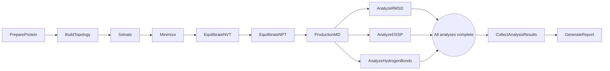

# Demonstração de sintaxe para composição de pipelines

Este documento explora uma interface fluente baseada em `Sequence` e
`Parallel`. É uma proposta conceitual: não executa GROMACS nem altera o
comportamento atual do gmxflow.

## Exemplo de composição

```python
workflow = (
    PrepareProtein()
    .then(Sequence(
        BuildTopology(),
        Solvate(),
        Minimize(),
        EquilibrateNVT(),
        EquilibrateNPT(),
        ProductionMD(),
    ))
    .then(Parallel(
        AnalyzeRMSD(),
        AnalyzeDSSP(),
        AnalyzeHydrogenBonds(),
    ))
    .then(Sequence(
        CollectAnalysisResults(),
        GenerateReport(),
    ))
)

workflow.run(project)
```

`Sequence` declara que cada etapa depende da anterior. `Parallel` declara que
as análises são independentes entre si e recebem os dados necessários da
produção. Isso descreve o grafo; não obriga que todas as análises sejam
executadas simultaneamente. O executor pode agendá-las em paralelo quando os
recursos permitirem. O `Sequence` seguinte começa depois que todos os ramos de
`Parallel` terminarem: esse ponto é uma barreira/junção. Assim,
`CollectAnalysisResults` pode consumir saídas de RMSD, DSSP e pontes de
hidrogênio, e `GenerateReport` aguarda a coleta.

## Como o grafo ficaria



As setas representam dependências de dados/artefatos, não necessariamente a
passagem de um objeto Python entre funções. Por exemplo, `ProductionMD`
produziria uma trajetória e um arquivo de estado; cada análise declararia qual
artefato consome. Isso permite validar o grafo antes de iniciar cálculos e
torna sua estrutura apresentável a um futuro editor visual. A junção também
precisa ser explícita no modelo interno: o executor só libera o próximo passo
quando todos os predecessores da junção concluírem com sucesso. Se uma análise
falhar, as etapas posteriores que dependem da junção não devem ser executadas.

Uma operação condicional seria diferente, por exemplo
`Branch(condition, if_true=..., if_false=...)`. Ela representa escolha entre
caminhos; não é a mesma coisa que `Parallel`, que representa múltiplos ramos
independentes. `Sequence` deixa a ordem explícita.

## Contrato comum dos passos

Um `Protocol` poderia definir o contrato estrutural comum sem obrigar os passos
incluídos no gmxflow a compartilhar uma hierarquia rígida. Para um caso muito
específico, um usuário com domínio de GROMACS poderia criar um passo próprio e
implementá-lo conforme esse contrato. Pydantic poderia validar os parâmetros
próprios desse passo; a execução comum continuaria sob responsabilidade do
executor do workflow.

```python
from typing import Protocol


class Step(Protocol):
    name: str
    inputs: tuple["Artifact", ...]
    outputs: tuple["Artifact", ...]
    parallel: bool

    def run(self, context: "RunContext") -> "RunContext": ...
```

Exemplo esquemático de um passo especializado:

```python
class CustomPullingAnalysis(Step):
    name = "custom-pulling-analysis"
    inputs = (Artifact("production-trajectory"),)
    outputs = (Artifact("pulling-analysis"),)
    parallel = True

    def run(self, context: RunContext) -> RunContext:
        # O especialista define aqui os comandos/opções GROMACS necessários.
        # O contexto fornece ao executor as entradas e saídas declaradas.
        ...
```

Em Python, `Protocol` é principalmente um contrato para tipagem estática; não
fornece por si só logging, retomada, execução de subprocessos ou outras
funcionalidades. A classe customizada pode declarar `Step` como base para
verificação pelo type checker, mas isso não lhe dá essas capacidades. Se
passos externos precisarem de métodos utilitários compartilhados, o projeto
poderá oferecer futuramente uma classe concreta opcional, por exemplo
`StepBase`, separada do `Protocol`. O executor ainda deve validar o contrato,
registrar o passo e preservar logs, estado, fingerprints e segurança de
arquivos.

`parallel` poderia indicar que o passo é elegível para compor um grupo
`Parallel`; não significa, sozinho, que ele será executado simultaneamente.
Isso depende também das dependências entre artefatos e dos recursos do
executor. Um passo continua sem conhecer seu antecessor ou sucessor: ele
declara os artefatos que consome e produz, e o validador do workflow verifica
se as conexões fazem sentido.

Essa verificação deve ocorrer em dois momentos distintos:

1. **Validação estrutural do grafo:** cada input é fornecido por uma entrada
   inicial do projeto ou por algum produtor que precede o passo no grafo; não
   há ciclos nem produtores ambíguos.
2. **Validação de execução:** os arquivos concretos existem e estão legíveis
   quando a etapa vai iniciar. Na validação estrutural, uma saída produzida por
   uma etapa ainda não executada naturalmente não existe no disco.

Restrições especiais de ordem — por exemplo, uma etapa que só faz sentido
depois de `ProductionMD` — podem ser expressas por requisitos de artefatos
específicos ou, se isso não for suficiente, por restrições declarativas de
tipos de predecessores. O validador central aplica essas regras; não se espera
que o objeto do passo descubra a posição em que foi colocado.

## Validações importantes

- Não exigir que o usuário escreva ou memorize nomes de etapas para conectá-las.
- Detectar inputs sem origem no projeto nem produtor alcançável, saídas
  duplicadas ou ambíguas e ciclos antes da execução.
- Garantir que os membros de `Parallel` sejam de fato independentes; se houver
  dependência entre eles, ela deve ser representada por `Sequence` ou por
  conexões explícitas no grafo interno. Uma flag `parallel` sozinha não prova
  independência.
- Definir `then(...)` após `Parallel(...)` como uma junção que aguarda todos os
  ramos e disponibiliza suas saídas ao passo seguinte.
- Mostrar grafo, parâmetros, entradas e saídas no dry-run sem executar comandos.
- Preservar retomada e definir o significado de `--from-step` e `--until` em
  grafos com múltiplos ramos.
- Manter escolhas científicas visíveis e sobrescrevíveis; defaults não devem
  ocultar protonação, seleções ou métodos.

O grafo é a representação interna e pode futuramente alimentar um editor
visual. `Sequence` e `Parallel` são os elementos visíveis nesta proposta; a
implementação ainda deve definir contratos de artefatos e regras de execução.
