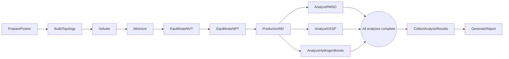

# Demonstração de sintaxe para composição de pipelines

Este documento descreve uma interface de workflow baseada em `Sequence` e
`Parallel`. O modelo e a validação estrutural do grafo estão implementados;
isso ainda não executa GROMACS nem altera o comportamento da pipeline atual.

## Exemplo de composição

```python
workflow = Sequence(
    PrepareProtein(),
    Sequence(
        BuildTopology(),
        Solvate(),
        Minimize(),
        EquilibrateNVT(),
        EquilibrateNPT(),
        ProductionMD(),
    ),
    Parallel(
        AnalyzeRMSD(),
        AnalyzeDSSP(),
        AnalyzeHydrogenBonds(),
    ),
    Sequence(
        CollectAnalysisResults(),
        GenerateReport(),
    ),
)

graph = WorkflowGraph.from_workflow(workflow, project_inputs=project.artifacts)
```

O exemplo é ilustrativo: as classes de etapa e `project.artifacts` ainda não
fazem parte da API implementada. `WorkflowGraph.from_workflow(...)` valida e
compila a estrutura, mas ainda não oferece execução.

`Sequence` declara que cada etapa depende da anterior. `Parallel` declara que
as análises são independentes entre si e recebem os dados necessários da
produção. Isso descreve o grafo; não obriga que todas as análises sejam
executadas simultaneamente. O executor pode agendá-las em paralelo quando os
recursos permitirem. O `Sequence` seguinte começa depois que todos os ramos de
`Parallel` terminarem: esse ponto é uma barreira/junção. Assim,
`CollectAnalysisResults` pode consumir saídas de RMSD, DSSP e pontes de
hidrogênio, e `GenerateReport` aguarda a coleta.

## Como o grafo ficaria



As setas representam dependências de dados/artefatos, não necessariamente a
passagem de um objeto Python entre funções. Por exemplo, `ProductionMD`
produziria uma trajetória e um arquivo de estado; cada análise declararia qual
artefato consome. Isso permite validar o grafo antes de iniciar cálculos e
torna sua estrutura apresentável a um futuro editor visual. A junção também
precisa ser explícita no modelo interno: o executor só libera o próximo passo
quando todos os predecessores da junção concluírem com sucesso. Se uma análise
falhar, as etapas posteriores que dependem da junção não devem ser executadas.

Uma operação condicional seria diferente, por exemplo
`Branch(condition, if_true=..., if_false=...)`. Ela representa escolha entre
caminhos; não é a mesma coisa que `Parallel`, que representa múltiplos ramos
independentes. `Sequence` deixa a ordem explícita.

## Contrato comum dos passos

O contrato será estrutural: `Step` é um `Protocol`, não uma superclasse
obrigatória. Isso permite que o gmxflow e extensões especializadas implementem
passos sem compartilhar herança. O `Protocol` define os dados e operações que
o planejador/executor pode esperar; ele não implementa logging, retomada nem
execução de subprocessos.

Cada passo declara:

- `id`: identificador estável, único no workflow e usado em logs, seleção e
  estado persistido. Não deve ser derivado do rótulo de apresentação nem mudar
  quando esse rótulo for traduzido ou editado.
- `name`: rótulo legível para exibição ao usuário.
- `inputs` e `outputs`: tuplas de `Artifact` nomeados. Cada artefato tem uma
  chave lógica estável e um tipo de conteúdo; o caminho físico é resolvido pelo
  projeto/planejador, não usado como identidade do artefato.
- `parallel`: declaração de elegibilidade para participar de `Parallel`, não
  promessa de execução simultânea.
- `run(context)`: execução do passo pelo executor comum. O contexto oferece
  apenas os artefatos de entrada declarados e os destinos de saída planejados;
  os detalhes concretos de `RunContext` serão definidos junto com a API de
  execução, sem transferir a responsabilidade operacional do executor para o
  passo.

Esboço do contrato (tipos auxiliares são conceituais nesta etapa):

```python
from typing import Protocol


class Step(Protocol):
    id: str
    name: str
    inputs: tuple[Artifact, ...]
    outputs: tuple[Artifact, ...]
    parallel: bool

    def run(self, context: RunContext) -> None: ...
```

O passo sinaliza falha lançando uma exceção; o executor a captura, associa ao
`id` do passo e produz o resultado/status estruturado do workflow. Não haverá
um `Success | Error` obrigatório no retorno de cada implementação: isso
duplicaria o mecanismo de exceções do Python e facilitaria que uma falha fosse
ignorada. Mensagens de erro devem incluir o `id` do passo e, quando aplicável,
a chave do artefato que causou a falha. Falha em um passo bloqueia todos os
seus sucessores dependentes; ramos independentes já iniciados poderão
concluir, mas a junção e seus sucessores ficam bloqueados.

`Artifact` terá identidade lógica (`key`) e tipo (`kind`); sua localização e
metadados de fingerprint são resolvidos em tempo de planejamento/execução.
Artefatos externos são declarados como entradas do projeto, fora da lista de
saídas dos passos. Para cada chave de artefato deve existir exatamente uma
origem: uma entrada do projeto ou a saída de um único passo. Dois passos não
podem produzir a mesma chave, mesmo se declararem caminhos diferentes. Um
artefato produzido por um passo não pode também ser declarado como entrada
externa.

`Sequence(a, b, ...)` estabelece ordem e permite que os artefatos declarados
como saída por um passo sejam consumidos por passos posteriores. A conexão
entre dois passos é inferida pela chave de artefato coincidente, não por
posição de arquivo nem por passagem implícita de um objeto Python. A ordem da
sequência, por si só, não cria dependências de dados para artefatos que nenhum
passo consome.

`Parallel(a, b, ...)` cria ramos sem dependência entre seus membros. Todo
input de cada membro precisa vir de uma entrada do projeto ou de um produtor
anterior ao grupo; um membro não pode consumir artefato produzido por outro
membro do mesmo grupo. Todos os membros devem declarar `parallel = True`.
`Parallel` expressa independência e uma barreira de junção, não execução
concorrente garantida. Depois do grupo, os outputs de todos os ramos ficam
disponíveis; uma sequência subsequente só inicia após todos os ramos
concluírem.

O identificador `id` é a chave lógica para logs e retomada. Para os passos
migrados, a primeira escolha será preservar os nomes atuais (por exemplo,
`prepare`, `topology`, `production`) como IDs, evitando invalidar estado
existente sem necessidade. A compatibilidade de formatos de estado, aliases e
mudanças futuras de ID será definida e testada antes da migração do executor;
esta decisão não autoriza reescrever ou descartar silenciosamente
`work/state.json`.

Pydantic poderá validar modelos de parâmetros de passos concretos, mas não é
requisito do `Protocol` nem substitui a validação central do grafo. Uma
implementação customizada deve satisfazer o contrato e declarar seus artefatos;
uma futura classe concreta auxiliar poderá ser oferecida sem tornar herança
obrigatória.

### Fronteiras de validação

1. **Validação estática do workflow:** IDs únicos; chaves de artefato e tipos
   coerentes; produtores únicos; toda entrada com origem no projeto ou em um
   produtor anterior; regras de `Sequence`/`Parallel` satisfeitas; nenhuma
   dependência cíclica; caminhos de saída sem colisão. Não exige que saídas
   futuras já existam no disco.
2. **Validação de execução:** entradas externas existem e são legíveis antes
   de iniciar os passos que delas dependem; saídas são verificadas após a
   execução; fingerprints e estado são atualizados pelo executor.

Restrições especiais de ordem, como exigir um artefato gerado por produção,
devem primeiro ser expressas pela chave e pelo tipo do artefato requerido. Um
mecanismo separado de restrições de predecessores só será considerado se um
caso real não puder ser representado dessa forma.

## Validações importantes

- Não exigir que o usuário escreva ou memorize nomes de etapas para conectá-las.
- Detectar inputs sem origem no projeto nem produtor alcançável, saídas
  duplicadas ou ambíguas e ciclos antes da execução.
- Garantir que os membros de `Parallel` sejam de fato independentes; se houver
  dependência entre eles, ela deve ser representada por `Sequence` ou por
  conexões explícitas no grafo interno. Uma flag `parallel` sozinha não prova
  independência.
- Definir `then(...)` após `Parallel(...)` como uma junção que aguarda todos os
  ramos e disponibiliza suas saídas ao passo seguinte.
- Mostrar grafo, parâmetros, entradas e saídas no dry-run sem executar comandos.
- Preservar retomada e definir o significado de `--from-step` e `--until` em
  grafos com múltiplos ramos.
- Manter escolhas científicas visíveis e sobrescrevíveis; defaults não devem
  ocultar protonação, seleções ou métodos.

O grafo é a representação interna e pode futuramente alimentar um editor
visual. `Sequence` e `Parallel` são os elementos visíveis nesta proposta; a
execução ainda deve definir a resolução dos artefatos em caminhos físicos e
integrar o grafo ao executor atual.

## Plano de migração

Este plano descreve uma migração gradual da pipeline atual para uma
representação em grafo. Cada etapa deve ser revisada e validada antes de
iniciar a seguinte. O plano não significa que a nova API ou os exemplos acima
já estejam implementados.

### 1. Fechar o contrato do modelo — concluída

**Escopo realizado:** definir o contrato estrutural de `Step`, a identidade
estável das etapas, a identidade/tipagem de artefatos, entradas do projeto,
saídas declaradas, composição de `Sequence` e `Parallel`, semântica da junção,
falhas e fronteiras de validação. Registrar a relação inicial entre IDs e os
nomes de etapas atualmente persistidos.

**Fora de escopo:** alterar a pipeline atual, parâmetros científicos ou
implementar execução paralela.

**Critério de aceite:** exemplos e regras de validação documentados sem
ambiguidades suficientes para implementar o modelo e seus testes sem tomar
decisões implícitas. Atendido nesta proposta; detalhes de tipos auxiliares e
do contexto concreto de execução permanecem para as etapas que os introduzem.

### 2. Implementar e validar o grafo sem executar GROMACS — concluída

**Escopo realizado:** adicionar `Artifact`, o contrato estrutural de `Step`,
`Sequence`, `Parallel` e `WorkflowGraph.from_workflow(...)` em
`src/gmxflow/pipeline.py`. O grafo valida IDs duplicados, entradas sem origem,
produtores duplicados ou conflitantes com entradas do projeto, tipos de
artefatos incompatíveis, dependências cíclicas, elegibilidade para `Parallel`
e dependências entre ramos paralelos. A ordem topológica e os predecessores
ficam disponíveis para inspeção.

**Fora de escopo:** executar comandos, mudar o executor atual, agendar trabalho
simultâneo ou resolver artefatos para caminhos físicos e detectar colisões de
caminho.

**Critério de aceite:** testes unitários demonstram grafos válidos e mensagens
de erro claras para estruturas inválidas; nenhum teste exige GROMACS. Atendido
em `tests/test_pipeline.py`.

### 3. Separar planejamento e execução

**Escopo:** introduzir um executor que consuma o grafo e preserve os
comportamentos operacionais existentes: comandos como sequências de
argumentos, logs por etapa, dry-run, fingerprints e retomada.

**Fora de escopo:** execução simultânea de etapas e mudanças nos comandos ou
parâmetros científicos.

**Critério de aceite:** testes com etapas falsas comprovam a ordem definida
pelas dependências, o bloqueio de sucessores após falha, o dry-run e a
preservação do estado sem depender de uma instalação de GROMACS.

### 4. Migrar uma fatia vertical representativa

**Escopo:** selecionar um trecho pequeno de um exemplo existente e migrá-lo
para o novo modelo, mantendo temporariamente a implementação antiga para
comparação. A seleção deve cobrir entradas, saídas e dependências reais sem
alterar escolhas científicas.

**Fora de escopo:** migrar todo o exemplo, todos os tutoriais ou mudar
force field, protonação, parâmetros de simulação e análise.

**Critério de aceite:** testes de regressão demonstram equivalência dos
comandos e dos arquivos esperados para as etapas migradas; qualquer diferença
necessária é documentada e aprovada explicitamente.

### 5. Migrar as demais etapas incrementalmente

**Escopo:** portar etapas em fatias pequenas, atualizando testes e exemplos a
cada fatia. Definir e testar a compatibilidade de identificadores, opções de
seleção de etapas e estado salvo para projetos existentes.

**Fora de escopo:** remover a implementação antiga antes da paridade, introduzir
um editor visual ou prometer suporte a todos os tutoriais de Lemkul.

**Critério de aceite:** cada fatia tem revisão e evidência de regressão; a
estratégia de compatibilidade ou migração do estado persistido está documentada
antes de ser aplicada a projetos de usuário.

### 6. Consolidar a API após demonstrar paridade

**Escopo:** tornar a nova composição a interface recomendada, atualizar a
documentação e exemplos, e remover o caminho antigo somente quando não houver
dependências restantes e a compatibilidade tiver sido tratada.

**Fora de escopo:** implementar plugins de terceiros ou editor visual como
parte obrigatória desta migração.

**Critério de aceite:** suíte completa aprovada, documentação distingue
funcionalidade disponível de planos futuros, e há orientação clara para
projetos criados com a versão anterior.

### Decisões adiadas

- Execução realmente paralela: requer definir limites de recursos, conflitos
  de arquivos, cancelamento e propagação de falhas. Até essa decisão, `Parallel`
  representa dependências independentes no grafo, mas o executor pode executá-las
  sequencialmente.
- Contrato de extensões de terceiros e eventual `StepBase`: avaliar depois que
  o protocolo e as necessidades dos passos internos forem exercitados.
- Escopo de tutoriais suportados: migrar um caso por vez e não inferir cobertura
  universal a partir da nova representação.

Nenhuma etapa deste plano autoriza mudanças científicas implícitas. Defaults,
parâmetros e métodos devem permanecer equivalentes ou ter qualquer alteração
apresentada para revisão humana explícita.
