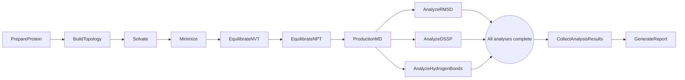

# Demonstração de sintaxe para composição de pipelines

Este documento descreve uma interface de workflow baseada em `Sequence` e
`Parallel`. O modelo, a validação estrutural e um executor sequencial do grafo
estão implementados. Esse executor ainda não substitui nem altera a pipeline
GROMACS atual do CLI.

## Exemplo de composição

```python
workflow = Sequence(
    PrepareProtein(),
    Sequence(
        BuildTopology(),
        Solvate(),
        Minimize(),
        EquilibrateNVT(),
        EquilibrateNPT(),
        ProductionMD(),
    ),
    Parallel(
        AnalyzeRMSD(),
        AnalyzeDSSP(),
        AnalyzeHydrogenBonds(),
    ),
    Sequence(
        CollectAnalysisResults(),
        GenerateReport(),
    ),
)

graph = WorkflowGraph.from_workflow(workflow, project_inputs=project.artifacts)
```

O exemplo é ilustrativo: as classes de etapa e `project.artifacts` ainda não
fazem parte da API implementada. `WorkflowGraph.from_workflow(...)` valida e
compila a estrutura. O executor pode executar implementações de `Step`, mas
esta demonstração ainda não associa as classes ilustrativas aos comandos e
artefatos da pipeline GROMACS atual.

`Sequence` declara que cada etapa depende da anterior. `Parallel` declara que
as análises são independentes entre si e recebem os dados necessários da
produção. Isso descreve o grafo; não obriga que todas as análises sejam
executadas simultaneamente. O executor pode agendá-las em paralelo quando os
recursos permitirem. O `Sequence` seguinte começa depois que todos os ramos de
`Parallel` terminarem: esse ponto é uma barreira/junção. Assim,
`CollectAnalysisResults` pode consumir saídas de RMSD, DSSP e pontes de
hidrogênio, e `GenerateReport` aguarda a coleta.

## Como o grafo ficaria



As setas representam dependências de dados/artefatos, não necessariamente a
passagem de um objeto Python entre funções. Por exemplo, `ProductionMD`
produziria uma trajetória e um arquivo de estado; cada análise declararia qual
artefato consome. Isso permite validar o grafo antes de iniciar cálculos e
torna sua estrutura apresentável a um futuro editor visual. A junção também
precisa ser explícita no modelo interno: o executor só libera o próximo passo
quando todos os predecessores da junção concluírem com sucesso. Se uma análise
falhar, as etapas posteriores que dependem da junção não devem ser executadas.

Uma operação condicional seria diferente, por exemplo
`Branch(condition, if_true=..., if_false=...)`. Ela representa escolha entre
caminhos; não é a mesma coisa que `Parallel`, que representa múltiplos ramos
independentes. `Sequence` deixa a ordem explícita.

## Contrato comum dos passos

O contrato será estrutural: `Step` é um `Protocol`, não uma superclasse
obrigatória. Isso permite que o gmxflow e extensões especializadas implementem
passos sem compartilhar herança. O `Protocol` define os dados e operações que
o planejador/executor pode esperar; ele não implementa logging, retomada nem
execução de subprocessos.

Cada passo declara:

- `id`: identificador estável, único no workflow e usado em logs, seleção e
  estado persistido. Não deve ser derivado do rótulo de apresentação nem mudar
  quando esse rótulo for traduzido ou editado.
- `name`: rótulo legível para exibição ao usuário.
- `inputs` e `outputs`: tuplas de `Artifact` nomeados. Cada artefato tem uma
  chave lógica estável e um tipo de conteúdo; o caminho físico é resolvido pelo
  projeto/planejador, não usado como identidade do artefato.
- `parallel`: declaração de elegibilidade para participar de `Parallel`, não
  promessa de execução simultânea.
- `version` e `state`: versão explícita da implementação do passo e um
  mapeamento JSON serializável com os parâmetros que afetam suas saídas. A
  versão deve ser incrementada quando uma alteração de implementação puder
  mudar os resultados sem que isso apareça em `state`.
- `run(context)`: execução do passo pelo executor comum. O contexto oferece
  apenas os caminhos dos artefatos de entrada/saída declarados e um método
  `run_command(argv, ...)`. O método executa argv sem shell e registra
  resultado, stdout e stderr no log do passo. Logging, verificação de arquivos,
  estado e retomada continuam sob responsabilidade do executor.

Esboço do contrato (tipos auxiliares são conceituais nesta etapa):

```python
from collections.abc import Mapping
from typing import Protocol

from gmxflow.pipeline import Artifact, RunContext


class Step(Protocol):
    id: str
    name: str
    inputs: tuple[Artifact, ...]
    outputs: tuple[Artifact, ...]
    parallel: bool
    version: str
    state: Mapping[str, object]

    def run(self, context: RunContext) -> None: ...
```

`RunContext` expõe `project_root`, `input_path(artifact)`,
`output_path(artifact)` e `run_command(argv, *, cwd=None, env=None,
stdin=None)`. O chamador fornece ao executor o mapa de chaves lógicas para
caminhos físicos; chaves ausentes, excedentes ou caminhos duplicados são
rejeitados antes da execução. Steps são código confiável: o contexto limita a
API suportada, mas Python não impede uma extensão de acessar arquivos ou
processos diretamente fora dela.

O passo sinaliza falha lançando uma exceção; o executor a captura, associa ao
`id` do passo e produz o resultado/status estruturado do workflow. Não haverá
um `Success | Error` obrigatório no retorno de cada implementação: isso
duplicaria o mecanismo de exceções do Python e facilitaria que uma falha fosse
ignorada. Mensagens de erro devem incluir o `id` do passo e, quando aplicável,
a chave do artefato que causou a falha. Falha em um passo bloqueia todos os
seus sucessores dependentes; ramos independentes já iniciados poderão
concluir, mas a junção e seus sucessores ficam bloqueados.

`Artifact` terá identidade lógica (`key`) e tipo (`kind`); sua localização e
metadados de fingerprint são resolvidos em tempo de planejamento/execução.
Artefatos externos são declarados como entradas do projeto, fora da lista de
saídas dos passos. Para cada chave de artefato deve existir exatamente uma
origem: uma entrada do projeto ou a saída de um único passo. Dois passos não
podem produzir a mesma chave, mesmo se declararem caminhos diferentes. Um
artefato produzido por um passo não pode também ser declarado como entrada
externa.

`Sequence(a, b, ...)` estabelece ordem e permite que os artefatos declarados
como saída por um passo sejam consumidos por passos posteriores. Steps que
herdam o mixin opcional `ComposableStep` podem usar `a | b`; `Sequence` e
`Parallel` também aceitam `|`, inclusive para continuar uma sequência após a
barreira do grupo. A forma `workflow |= next_step` é a reatribuição normal do
resultado de `|`, não altera o grafo já criado. Steps que apenas implementam o
`Protocol` estrutural podem continuar usando `Sequence(a, b)` explicitamente.
A conexão entre dois passos é inferida pela chave de artefato coincidente, não por
posição de arquivo nem por passagem implícita de um objeto Python. A ordem da
sequência, por si só, não cria dependências de dados para artefatos que nenhum
passo consome.

`Parallel(a, b, ...)` cria ramos sem dependência entre seus membros. Todo
input de cada membro precisa vir de uma entrada do projeto ou de um produtor
anterior ao grupo; um membro não pode consumir artefato produzido por outro
membro do mesmo grupo. Todos os membros devem declarar `parallel = True`.
`Parallel` expressa independência e uma barreira de junção, não execução
concorrente garantida. Depois do grupo, os outputs de todos os ramos ficam
disponíveis; uma sequência subsequente só inicia após todos os ramos
concluírem.

O identificador `id` é a chave lógica para logs e retomada. Para os passos
migrados, a primeira escolha será preservar os nomes atuais (por exemplo,
`prepare`, `topology`, `production`) como IDs, evitando invalidar estado
existente sem necessidade. A compatibilidade de formatos de estado, aliases e
mudanças futuras de ID será definida e testada antes da migração do executor;
esta decisão não autoriza reescrever ou descartar silenciosamente
`work/state.json`.

Pydantic poderá validar modelos de parâmetros de passos concretos, mas não é
requisito do `Protocol` nem substitui a validação central do grafo. Uma
implementação customizada deve satisfazer o contrato e declarar seus artefatos.
`ComposableStep` é um mixin opcional para habilitar `|`; herança não é necessária
para Steps compostos explicitamente com `Sequence` ou `Parallel`.

`GmxFlowProject.workflow(...)` constrói os Steps concretos do projeto, sem
validar entradas nem executar comandos. O resultado pode ser combinado com
Steps customizados usando `|` ou `Sequence`. `run_workflow(...)` executa tanto
workflows customizados quanto composições com Steps internos. Para os Steps
GROMACS, o projeto infere os caminhos de artefatos; o chamador fornece somente
os caminhos de artefatos customizados. Entradas externas são inferidas pelas
chaves sem produtor, ou podem ser declaradas explicitamente por
`project_inputs`.

Em uma execução real que contenha `GromacsCommandStep`,
`run_workflow(...)` valida os pré-requisitos do projeto e prepara o workspace
antes de executar. Workflows
somente customizados não acionam esse setup. `dry_run=True` valida a estrutura e
os caminhos sem validar pré-requisitos GROMACS nem alterar o workspace. O
chamador escolhe um nome de estado JSON customizado, salvo dentro de `work/`.
Steps customizados continuam responsáveis pela operação científica que
declaram e devem usar o `RunContext` para acessar artefatos e executar
comandos.
Os nomes `state.json` e `workflow_state.json` (sem distinção entre maiúsculas e
minúsculas) são reservados para os estados dos executores padrão e não podem
ser usados por workflows customizados.

```python
report = project.run_workflow(
    workflow,
    project_inputs=(structure,),
    artifact_paths={
        "structure": project.root / "inputs" / "structure.pdb",
        "clean_structure": project.root / "work" / "custom" / "structure.pdb",
    },
    state_name="custom-preparation.json",
)
```

### Fronteiras de validação

1. **Validação estática do workflow:** IDs únicos; chaves de artefato e tipos
   coerentes; produtores únicos; toda entrada com origem no projeto ou em um
   produtor anterior; regras de `Sequence`/`Parallel` satisfeitas; nenhuma
   dependência cíclica; caminhos de saída sem colisão. Não exige que saídas
   futuras já existam no disco.
2. **Validação de execução:** entradas externas existem e são legíveis antes
   de iniciar os passos que delas dependem; saídas são verificadas após a
   execução; fingerprints e estado são atualizados pelo executor. Para
   reutilizar uma saída, devem existir todas as saídas declaradas e coincidir
   versão, `state`, fingerprints das entradas e fingerprints das saídas salvas.

Restrições especiais de ordem, como exigir um artefato gerado por produção,
devem primeiro ser expressas pela chave e pelo tipo do artefato requerido. Um
mecanismo separado de restrições de predecessores só será considerado se um
caso real não puder ser representado dessa forma.

## Validações importantes

- Não exigir que o usuário escreva ou memorize nomes de etapas para conectá-las.
- Detectar inputs sem origem no projeto nem produtor alcançável, saídas
  duplicadas ou ambíguas e ciclos antes da execução.
- Garantir que os membros de `Parallel` sejam de fato independentes; se houver
  dependência entre eles, ela deve ser representada por `Sequence` ou por
  conexões explícitas no grafo interno. Uma flag `parallel` sozinha não prova
  independência.
- Definir `then(...)` após `Parallel(...)` como uma junção que aguarda todos os
  ramos e disponibiliza suas saídas ao passo seguinte.
- No dry-run voltado ao usuário, mostrar grafo, parâmetros, entradas e saídas
  sem executar comandos. O executor atual retorna a ordem, dependências e mapa
  de caminhos; a apresentação de parâmetros por etapa e a integração ao dry-run
  do CLI ficam para a migração vertical.
- Preservar retomada e definir o significado de `--from-step` e `--until` em
  grafos com múltiplos ramos.
- Manter escolhas científicas visíveis e sobrescrevíveis; defaults não devem
  ocultar protonação, seleções ou métodos.

O grafo é a representação interna e pode futuramente alimentar um editor
visual. `Sequence` e `Parallel` são os elementos visíveis nesta proposta. O
executor novo executa os Steps sequencialmente; `Parallel` ainda não agenda
concorrência. O dry-run do grafo retorna etapas, dependências e caminhos sem
chamar `Step.run`; como os comandos podem ser dinâmicos, ele não os prevê. O
dry-run existente do CLI permanece inalterado enquanto a pipeline atual não
for migrada.

## Plano de migração

Este plano descreve uma migração gradual da pipeline atual para uma
representação em grafo. Cada etapa deve ser revisada e validada antes de
iniciar a seguinte. O plano não significa que a nova API ou os exemplos acima
já estejam implementados.

### 1. Fechar o contrato do modelo — concluída

**Escopo realizado:** definir o contrato estrutural de `Step`, a identidade
estável das etapas, a identidade/tipagem de artefatos, entradas do projeto,
saídas declaradas, composição de `Sequence` e `Parallel`, semântica da junção,
falhas e fronteiras de validação. Registrar a relação inicial entre IDs e os
nomes de etapas atualmente persistidos.

**Fora de escopo:** alterar a pipeline atual, parâmetros científicos ou
implementar execução paralela.

**Critério de aceite:** exemplos e regras de validação documentados sem
ambiguidades suficientes para implementar o modelo e seus testes sem tomar
decisões implícitas. Atendido nesta proposta; detalhes de tipos auxiliares e
do contexto concreto de execução permanecem para as etapas que os introduzem.

### 2. Implementar e validar o grafo sem executar GROMACS — concluída

**Escopo realizado:** adicionar `Artifact`, o contrato estrutural de `Step`,
`Sequence`, `Parallel` e `WorkflowGraph.from_workflow(...)` em
`src/gmxflow/pipeline.py`. O grafo valida IDs duplicados, entradas sem origem,
produtores duplicados ou conflitantes com entradas do projeto, tipos de
artefatos incompatíveis, dependências cíclicas, elegibilidade para `Parallel`
e dependências entre ramos paralelos. A ordem topológica e os predecessores
ficam disponíveis para inspeção.

**Fora de escopo:** executar comandos, mudar o executor atual, agendar trabalho
simultâneo ou resolver artefatos para caminhos físicos e detectar colisões de
caminho.

**Critério de aceite:** testes unitários demonstram grafos válidos e mensagens
de erro claras para estruturas inválidas; nenhum teste exige GROMACS. Atendido
em `tests/test_pipeline.py`.

### 3. Separar planejamento e execução — concluída

**Escopo realizado:** adicionar `RunContext` com acesso restrito aos artefatos
declarados, resolução das chaves lógicas para caminhos físicos e execução de
comandos argv; adicionar `version` e `state` ao contrato `Step`; implementar
`run_workflow_graph(...)` com logs por etapa, dry-run estrutural, verificação
de inputs/outputs, rejeição de caminhos duplicados, fingerprints, retomada e
bloqueio de sucessores após falha. Ramo independente que ainda não depende da
falha pode terminar; a execução continua sequencial.

**Fora de escopo:** conectar o novo executor ao CLI ou à pipeline GROMACS,
execução concorrente, mudanças em comandos existentes ou parâmetros
científicos. O dry-run estrutural não antecipa comandos gerados dinamicamente.

**Critério de aceite:** testes com Steps falsos comprovam ordem, bloqueio de
sucessores, continuação de ramo independente, dry-run sem efeitos colaterais,
logs argv e retomada por versão/estado/fingerprints sem depender de GROMACS.
Atendido em `tests/test_workflow_executor.py`.

### 4. Migrar uma fatia vertical representativa — concluída (API experimental)

**Escopo realizado:** a etapa `prepare` do pipeline real agora é adaptada ao
contrato `Step` e executada pelo grafo quando `GmxFlowProject.run()` recebe um
plano iniciado nessa etapa. A preparação continua usando o mesmo comando,
entradas, saídas e estado definidos por `build_pipeline()`. O CLI permanece
inalterado e a implementação antiga é mantida para comparação. A etapa
`topology` é a primeira fatia da etapa 5, descrita abaixo.

**Fora de escopo:** migrar o CLI, as demais etapas, todo o exemplo ou todos os
tutoriais; mudar force field, protonação, parâmetros de simulação e análise;
validar resultados científicos com GROMACS.

**Critério de aceite:** testes confirmam que o grafo preserva os comandos e os
artefatos declarados e comparam a chamada normalizada e os arquivos de saída
com o executor legado usando um subprocesso simulado. Essa comparação valida a
integração do software, não a preparação molecular nem a validade científica.
O estado do grafo é gravado separadamente em `work/workflow_state.json`, sem
sobrescrever `work/state.json` do CLI. Os caches são independentes, portanto a
primeira execução por um executor sem estado próprio pode executar a etapa
novamente. Atendido em `tests/test_api.py` e `tests/test_pipeline.py`.

### 5. Migrar as demais etapas incrementalmente — concluída

**Escopo:** portar etapas em fatias pequenas, atualizando testes e exemplos a
cada fatia. Definir e testar a compatibilidade de identificadores, opções de
seleção de etapas e estado salvo para projetos existentes.

**Implementação concluída:** `GmxFlowProject.run()` compõe o plano selecionado em
um único `Sequence` e o executa pelo executor do grafo; não há mais divisão da
execução por uma allowlist de nomes de etapa. `PrepareComplexStep` é usado em
todos os perfis e, para `small_molecule`, `LigandTopologyStep`,
`ProteinTopologyStep` e `AssembleComplexStep` também são implementações
concretas do contrato `Step`. As etapas `box`, `solvate`, `ions-grompp` e
`ions` também são classes concretas (`CreateBoxStep`, `SolvateSystemStep`,
`PrepareIonsStep` e `AddIonsStep`) em todos os perfis. `build_pipeline()` projeta
essas mesmas definições como `PipelineStep` para manter o CLI legado. As etapas
`em-grompp` e `em` também são classes concretas (`PrepareEnergyMinimizationStep`
e `EnergyMinimizationStep`); `nvt-grompp` e `nvt` também (`PrepareNvtStep` e
`NvtEquilibrationStep`); `npt-grompp` e `npt` também (`PrepareNptStep` e
`NptEquilibrationStep`); `production-grompp` e `production` também
(`PrepareProductionStep` e `ProductionStep`). O pós-processamento estrutural da
trajetória (`pbc-nojump`, `pbc-center` e `fit`) também tem Steps concretos:
`RemovePeriodicJumpsStep`, `CenterTrajectoryStep` e `FitTrajectoryStep`. As
etapas `analysis` e `thermodynamics` também agora são `AnalyzeTrajectoryStep` e
`ThermodynamicsStep`; quando habilitadas, `interaction-energy` e `sasa` são
`InteractionEnergyStep` e `SasaStep`. Plotagem e relatório são `PlotAnalysisStep`
e `ReportStep`. Para projetos sem molécula pequena, a topologia agora é
`BuildTopologyStep`; a classe preserva os caminhos de saída distintos para
proteína isolada e peptídeo. Assim, todas as etapas produzidas atualmente são
classes concretas. O adaptador genérico `PipelineCommandStep` foi removido da
API; se um plano incluir uma etapa sem implementação concreta correspondente,
a composição falha explicitamente. O CLI continua usando `PipelineStep` por
meio de `build_pipeline()`, que projeta a mesma lista canônica de etapas
concretas usada por `build_workflow()`. A API compõe essa lista diretamente ou
valida a projeção ao receber uma seleção de etapas do CLI. A sequência atual
não usa `Parallel`.

**Compatibilidade do executor:** toda execução pela API usa agora
`work/workflow_state.json`; o CLI segue usando `work/state.json`. Esses estados
não são convertidos entre si, portanto a primeira execução pela API pode
reexecutar etapas que só tenham estado salvo pelo executor antigo. A mudança
não altera comandos, parâmetros ou ordem científica das etapas.

No fluxo `small_molecule`, a topologia original da proteína é preservada em
`work/topo/topol.top`; `AssembleComplexStep` cria
`work/topo/topol_complex.top`, consumida pela etapa `solvate`.

**Versões de topologia:** `work/topo/topol.top` permanece como saída original
da geração de topologia. Para `small_molecule`, `assemble-complex` cria
`topol_complex.top`; `solvate` usa essa versão como entrada e cria
`topol_solvated.top`. `genion` cria `topol_ions.top`; as etapas posteriores de
simulação e a análise de interação consomem esta última. Isso permite
inspecionar cada versão sem alterar os parâmetros ou a sequência científica.

**Composição com extensões:** `GmxFlowProject.workflow(...)` expõe os Steps
concretos, com seleção compatível com `from_step` e `until`. Eles podem ser
combinados a Steps customizados e executados por `run_workflow(...)`. O método
infere entradas externas e caminhos dos Steps GROMACS; exige caminhos explícitos
para artefatos lógicos customizados; valida o mapa antes do setup; e, em
execução real, preserva a validação do projeto e a preparação do workspace. O
dry-run não cria diretórios nem executa setup. Callbacks de início e conclusão
recebem os Steps/resultados estruturados do executor.

**Compatibilidade concluída:** os IDs legados são preservados; `from_step` e
`until` continuam sendo aplicados pelo plano linear compatível usado pelo CLI
e por `GmxFlowProject.workflow(...)`. O CLI mantém `work/state.json`; a execução
por grafo usa `work/workflow_state.json`, sem conversão, sobrescrita ou
retomada cruzada. Workflows customizados usam um nome de estado próprio e os
dois nomes padrão são reservados. Retomada por etapa, versão, estado e
fingerprints é coberta nos testes do executor e da API.

**Verificação:** `tests/test_api.py` compara os comandos e os arquivos
produzidos pelos dois executores com um subprocesso simulado; não substitui uma
execução real do GROMACS nem valida resultados científicos.

**Fora de escopo:** remover a implementação antiga antes da paridade, introduzir
um editor visual ou prometer suporte a todos os tutoriais de Lemkul.

**Critério de aceite:** etapas concretas e integração mista são verificadas
com testes sem depender de GROMACS; IDs, seleção e estados separados estão
documentados e cobertos por testes de retomada. Atendido em
`tests/test_api.py`, `tests/test_pipeline.py` e
`tests/test_workflow_executor.py`. Esses testes verificam integração do
software; não validam resultados científicos ou substituem um ensaio real com
GROMACS.

### 6. Consolidar a API após demonstrar paridade — parcial; desacoplamento pendente

**Escopo:** tornar a nova composição a interface recomendada, atualizar a
documentação e exemplos, e remover o caminho antigo somente quando não houver
dependências restantes e a compatibilidade tiver sido tratada.

**Fatia inicial concluída:** os notebooks mantidos em `examples/` e o template
de `startproject` constroem o workflow com `project.workflow()` e o executam
com `project.run_workflow(workflow)`. A API define `project-workflow.json` como
estado padrão para essa composição, sem misturá-lo ao estado do CLI ou ao estado
mantido pelo método legado `project.run()`. `project.show_execution(...)` e a
apresentação nativa no notebook aceitam os resultados de ambas as interfaces.
`project.run()` continua disponível; esta etapa não o remove nem o depreca.
Projetos existentes não convertem seus estados automaticamente: ao adotar
`run_workflow()`, a retomada passa de `work/workflow_state.json` para
`work/project-workflow.json`, podendo repetir etapas. A orientação para manter
o método antigo ou fazer backup dos artefatos antes da troca está em
[`install-gmxflow-without-uv.md`](../how-to/install-gmxflow-without-uv.md#projetos-existentes-e-a-api-de-workflow).

**Compatibilidade mantida deliberadamente:** o comando `gmxflow run` ainda usa
`GmxFlowProject.plan()`, a projeção `PipelineStep` e o executor legado para
preservar as opções do CLI e o estado `work/state.json`. Essa dependência impede
remover agora a projeção e o executor antigos. A migração do CLI, incluindo
compatibilidade e eventual conversão do estado persistido, é trabalho separado
e não é necessária para recomendar a composição Python nos notebooks.

**Concluído nesta etapa até aqui:** exemplos, template de novos projetos,
documentação e guia para projetos existentes usam/distinguem a API composta.
A suíte completa passou com 212 testes aprovados e 1 desmarcado. Isso valida a
experiência recomendada, mas não conclui a consolidação arquitetural: a fábrica
do workflow ainda depende do formato legado.

O uso atual de `project.workflow()` seguido de `project.run_workflow()` é uma
ponte intermediária: a primeira chamada esconde a lista de etapas que deveria
ser compreensível e editável pelo usuário. Não deve ser tratado como o desenho
final da interface humana.

```python
workflow = project.workflow()
execution_report = project.run_workflow(workflow)
project.show_execution(execution_report)
```

O notebook demonstra a forma recomendada, mas a composição continua
experimental e não altera parâmetros ou ordem científica. Projetos existentes
mantêm configuração, entradas e estados; a nova chamada grava seu próprio
estado em `work/project-workflow.json`.

**Fora de escopo:** implementar plugins de terceiros ou editor visual como
parte obrigatória desta migração.

### Plano Para Uma Única Forma De Compor E Executar Pipelines

**Objetivo:** manter uma só definição canônica de Steps, um só modelo de
composição e um só executor. Não apagar código por contagem de linhas: cada
remoção precisa decorrer de uma dependência eliminada e de testes substitutos
que preservem comportamento, retomada e segurança dos arquivos.

**Auditoria atual:** `GmxFlowProject.workflow()` chama `plan()`, que produz
`PipelineStep`; `build_workflow(..., selected_steps=...)` reconstrói os Steps
concretos e os compara com essa projeção por `to_pipeline_step()`. Já
`run_workflow()` executa os Steps pelo grafo. O CLI ainda consome `plan()`,
`PipelineStep` e `run_steps()`, com estado em `work/state.json`. Há, portanto,
uma ponte de montagem dentro da API e um segundo caminho de execução no CLI.

#### A. Fixar o contrato público e a experiência das receitas — decisão antes de refatorar

- Adotar como sintaxe de composição linear o operador `|` e `Parallel(...)`
  para ramificações; `Sequence` será a representação normalizada interna, não
  uma segunda forma pública de montar a mesma sequência.
- Expor as classes de Step necessárias para compor tanto as tarefas internas
  quanto as extensões do usuário. O código do notebook deve mostrar a sequência
  realmente executada; nenhuma chamada deve criar silenciosamente uma pipeline
  completa que o usuário não consegue inspecionar.
- Manter `run_workflow(workflow)` somente como executor do objeto que já foi
  composto. A chamada de execução não substitui nem esconde a definição da
  pipeline.
- Fazer `gmxflow startproject` aceitar uma receita opcional para tarefas
  comuns. A receita deve gerar uma composição explícita e editável em
  `project.ipynb`, e não chamar um wrapper fechado em tempo de execução.
- Resolver explicitamente como um Step que satisfaz o `Protocol` participa do
  operador `|` — por mixin/base composável ou outra decisão única — antes de
  declarar o contrato estável. Não manter duas sintaxes públicas equivalentes.

**Aceite:** o notebook gerado deixa visíveis as classes/etapas, sua ordem,
ramos de `Parallel` e artefatos; os parâmetros científicos ficam explícitos
em `project.toml` e referenciados no notebook. Uma pessoa consegue editar ou
remover um Step sem abrir o executor. Um workflow montado manualmente e uma
receita gerada usam as mesmas classes e o mesmo operador. Não há API pública
`add/connect` nem wrapper de execução que decida a composição pelo usuário.

#### B. Remover a projeção legada da construção da API

- Fazer `project.workflow()` construir diretamente a sequência canônica de
  Steps a partir da configuração e da seleção por ID.
- Reimplementar validação e seleção (`strict_inputs`, `from_step`, `until`)
  sobre o modelo canônico, sem chamar `project.plan()` ou `build_pipeline()`.
- Remover `GromacsCommandStep.to_pipeline_step()` e a comparação de igualdade
  com `PipelineStep` somente depois de não haver consumidores.

**Aceite:** testes verificam comandos, artefatos, IDs, ordem e seleção a partir
dos Steps canônicos; a API pode construir e executar sem importar
`PipelineStep`/`build_pipeline`.

#### C. Gerar receitas visíveis para tarefas comuns

- Começar com uma receita de integração `smoke` e uma receita científica
  selecionada de um tutorial Lemkul, por exemplo Lysozyme in Water; cada receita
  deve ter escopo e fonte de referência declarados.
- Gerar as chamadas de Step no notebook como código normal editável, junto das
  entradas esperadas e dos parâmetros que o projeto já suporta. A receita
  determina somente a sequência de operações; não deve inventar defaults
  científicos nem afirmar equivalência ao tutorial quando faltarem campos.
- Auditar os campos de configuração requeridos por cada receita e registrar
  lacunas como trabalho separado, sujeito a revisão científica humana.

**Aceite:** testes de `startproject` verificam conteúdo e legibilidade do
notebook por receita, a ausência de execução automática e a preservação de
arquivos existentes. A receita smoke é identificada como teste de integração;
nenhum resultado dela é apresentado como evidência científica.

#### D. Unificar o caminho de execução, preservando a interface do CLI

- Adaptar o CLI para inspecionar e executar o mesmo workflow/grafo, mantendo
  `--project`, `--dry-run`, `--strict-inputs`, `--from-step` e `--until`, além
  das mensagens de progresso, logs e códigos de saída.
- Fazer o dry-run apresentar os Steps e dependências do grafo; não construir
  outro plano paralelo só para imprimir comandos.
- Substituir os adaptadores públicos duplicados (`project.run()`, callbacks e
  `ExecutionReport` versus `WorkflowExecutionReport`) por uma única interface;
  manter compatibilidade temporária apenas se a política de release exigir.

**Aceite:** testes do CLI e da API exercitam o mesmo executor e demonstram
paridade de argv, stdin, ambiente, logs, validação, falha, retomada e seleção.
Nenhum comportamento científico é alterado nesta etapa.

#### E. Decidir e testar a migração do estado persistido

Antes de trocar o executor do CLI, revisar os formatos atuais: CLI em
`work/state.json`, API legada em `work/workflow_state.json`, e workflows
customizados em `work/<state_name>`. Escolher uma política explícita:

1. conversão verificável de registros antigos para o formato único, apenas
   quando comando, entradas, saídas e parâmetros puderem ser comparados; ou
2. migração incompatível para 1.0, preservando os arquivos antigos e avisando
   claramente que etapas poderão ser executadas de novo.

**Aceite:** testes cobrem estado ausente, completo, inválido e incompatível;
nenhum arquivo de estado anterior é sobrescrito ou apagado silenciosamente.
Esta decisão requer revisão humana antes de implementar.

#### F. Excluir código e testes duplicados após a migração

- Só então remover `PipelineStep`, `build_pipeline()`, `run_steps()`/
  `run_step()`, seleção antiga, projeções e formatador de dry-run que não
  tenham mais consumidores.
- Migrar os testes que atualmente afirmam a implementação antiga; preservar
  cobertura de comandos, artefatos, segurança, retomada e mensagens sem manter
  testes duplicados apenas para confirmar duas implementações.
- Manter a execução de processos e a lógica de domínio que continuarem sendo
  usadas pelo executor canônico; tamanho de arquivo, isoladamente, não torna
  código descartável.

**Aceite final:** busca de referências confirma que não há chamadas/imports do
executor antigo; testes completos, lint, tipos e smoke de integração aprovados;
documentação oferece uma única forma de composição e explica a política de
estado para projetos anteriores. O smoke continua sendo validação de software,
nunca evidência científica.

**Critério de aceite:** suíte completa aprovada, documentação distingue
funcionalidade disponível de planos futuros, e há orientação clara para
projetos criados com a versão anterior.

### Decisões adiadas

- Execução realmente paralela: requer definir limites de recursos, conflitos
  de arquivos, cancelamento e propagação de falhas. Até essa decisão, `Parallel`
  representa dependências independentes no grafo, mas o executor pode executá-las
  sequencialmente.
- Contrato de extensões de terceiros e eventual `StepBase`: avaliar depois que
  o protocolo e as necessidades dos passos internos forem exercitados.
- Escopo de tutoriais suportados: migrar um caso por vez e não inferir cobertura
  universal a partir da nova representação.

Nenhuma etapa deste plano autoriza mudanças científicas implícitas. Defaults,
parâmetros e métodos devem permanecer equivalentes ou ter qualquer alteração
apresentada para revisão humana explícita.
