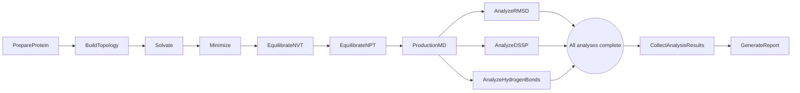

# Demonstração de sintaxe para composição de pipelines

Este documento descreve uma interface de workflow baseada em `Sequence` e
`Parallel`. O modelo, a validação estrutural e um executor sequencial do grafo
estão implementados. Esse executor ainda não substitui nem altera a pipeline
GROMACS atual do CLI.

## Exemplo de composição

```python
workflow = Sequence(
    PrepareProtein(),
    Sequence(
        BuildTopology(),
        Solvate(),
        Minimize(),
        EquilibrateNVT(),
        EquilibrateNPT(),
        ProductionMD(),
    ),
    Parallel(
        AnalyzeRMSD(),
        AnalyzeDSSP(),
        AnalyzeHydrogenBonds(),
    ),
    Sequence(
        CollectAnalysisResults(),
        GenerateReport(),
    ),
)

graph = WorkflowGraph.from_workflow(workflow, project_inputs=project.artifacts)
```

O exemplo é ilustrativo: as classes de etapa e `project.artifacts` ainda não
fazem parte da API implementada. `WorkflowGraph.from_workflow(...)` valida e
compila a estrutura. O executor pode executar implementações de `Step`, mas
esta demonstração ainda não associa as classes ilustrativas aos comandos e
artefatos da pipeline GROMACS atual.

`Sequence` declara que cada etapa depende da anterior. `Parallel` declara que
as análises são independentes entre si e recebem os dados necessários da
produção. Isso descreve o grafo; não obriga que todas as análises sejam
executadas simultaneamente. O executor pode agendá-las em paralelo quando os
recursos permitirem. O `Sequence` seguinte começa depois que todos os ramos de
`Parallel` terminarem: esse ponto é uma barreira/junção. Assim,
`CollectAnalysisResults` pode consumir saídas de RMSD, DSSP e pontes de
hidrogênio, e `GenerateReport` aguarda a coleta.

## Como o grafo ficaria



As setas representam dependências de dados/artefatos, não necessariamente a
passagem de um objeto Python entre funções. Por exemplo, `ProductionMD`
produziria uma trajetória e um arquivo de estado; cada análise declararia qual
artefato consome. Isso permite validar o grafo antes de iniciar cálculos e
torna sua estrutura apresentável a um futuro editor visual. A junção também
precisa ser explícita no modelo interno: o executor só libera o próximo passo
quando todos os predecessores da junção concluírem com sucesso. Se uma análise
falhar, as etapas posteriores que dependem da junção não devem ser executadas.

Uma operação condicional seria diferente, por exemplo
`Branch(condition, if_true=..., if_false=...)`. Ela representa escolha entre
caminhos; não é a mesma coisa que `Parallel`, que representa múltiplos ramos
independentes. `Sequence` deixa a ordem explícita.

## Contrato comum dos passos

O contrato será estrutural: `Step` é um `Protocol`, não uma superclasse
obrigatória. Isso permite que o gmxflow e extensões especializadas implementem
passos sem compartilhar herança. O `Protocol` define os dados e operações que
o planejador/executor pode esperar; ele não implementa logging, retomada nem
execução de subprocessos.

Cada passo declara:

- `id`: identificador estável, único no workflow e usado em logs, seleção e
  estado persistido. Não deve ser derivado do rótulo de apresentação nem mudar
  quando esse rótulo for traduzido ou editado.
- `name`: rótulo legível para exibição ao usuário.
- `inputs` e `outputs`: tuplas de `Artifact` nomeados. Cada artefato tem uma
  chave lógica estável e um tipo de conteúdo; o caminho físico é resolvido pelo
  projeto/planejador, não usado como identidade do artefato.
- `parallel`: declaração de elegibilidade para participar de `Parallel`, não
  promessa de execução simultânea.
- `version` e `state`: versão explícita da implementação do passo e um
  mapeamento JSON serializável com os parâmetros que afetam suas saídas. A
  versão deve ser incrementada quando uma alteração de implementação puder
  mudar os resultados sem que isso apareça em `state`.
- `run(context)`: execução do passo pelo executor comum. O contexto oferece
  apenas os caminhos dos artefatos de entrada/saída declarados e um método
  `run_command(argv, ...)`. O método executa argv sem shell e registra
  resultado, stdout e stderr no log do passo. Logging, verificação de arquivos,
  estado e retomada continuam sob responsabilidade do executor.

Esboço do contrato (tipos auxiliares são conceituais nesta etapa):

```python
from collections.abc import Mapping
from typing import Protocol

from gmxflow.pipeline import Artifact, RunContext


class Step(Protocol):
    id: str
    name: str
    inputs: tuple[Artifact, ...]
    outputs: tuple[Artifact, ...]
    parallel: bool
    version: str
    state: Mapping[str, object]

    def run(self, context: RunContext) -> None: ...
```

`RunContext` expõe `project_root`, `input_path(artifact)`,
`output_path(artifact)` e `run_command(argv, *, cwd=None, env=None,
stdin=None)`. O chamador fornece ao executor o mapa de chaves lógicas para
caminhos físicos; chaves ausentes, excedentes ou caminhos duplicados são
rejeitados antes da execução. Steps são código confiável: o contexto limita a
API suportada, mas Python não impede uma extensão de acessar arquivos ou
processos diretamente fora dela.

O passo sinaliza falha lançando uma exceção; o executor a captura, associa ao
`id` do passo e produz o resultado/status estruturado do workflow. Não haverá
um `Success | Error` obrigatório no retorno de cada implementação: isso
duplicaria o mecanismo de exceções do Python e facilitaria que uma falha fosse
ignorada. Mensagens de erro devem incluir o `id` do passo e, quando aplicável,
a chave do artefato que causou a falha. Falha em um passo bloqueia todos os
seus sucessores dependentes; ramos independentes já iniciados poderão
concluir, mas a junção e seus sucessores ficam bloqueados.

`Artifact` terá identidade lógica (`key`) e tipo (`kind`); sua localização e
metadados de fingerprint são resolvidos em tempo de planejamento/execução.
Artefatos externos são declarados como entradas do projeto, fora da lista de
saídas dos passos. Para cada chave de artefato deve existir exatamente uma
origem: uma entrada do projeto ou a saída de um único passo. Dois passos não
podem produzir a mesma chave, mesmo se declararem caminhos diferentes. Um
artefato produzido por um passo não pode também ser declarado como entrada
externa.

`Sequence(a, b, ...)` estabelece ordem e permite que os artefatos declarados
como saída por um passo sejam consumidos por passos posteriores. A conexão
entre dois passos é inferida pela chave de artefato coincidente, não por
posição de arquivo nem por passagem implícita de um objeto Python. A ordem da
sequência, por si só, não cria dependências de dados para artefatos que nenhum
passo consome.

`Parallel(a, b, ...)` cria ramos sem dependência entre seus membros. Todo
input de cada membro precisa vir de uma entrada do projeto ou de um produtor
anterior ao grupo; um membro não pode consumir artefato produzido por outro
membro do mesmo grupo. Todos os membros devem declarar `parallel = True`.
`Parallel` expressa independência e uma barreira de junção, não execução
concorrente garantida. Depois do grupo, os outputs de todos os ramos ficam
disponíveis; uma sequência subsequente só inicia após todos os ramos
concluírem.

O identificador `id` é a chave lógica para logs e retomada. Para os passos
migrados, a primeira escolha será preservar os nomes atuais (por exemplo,
`prepare`, `topology`, `production`) como IDs, evitando invalidar estado
existente sem necessidade. A compatibilidade de formatos de estado, aliases e
mudanças futuras de ID será definida e testada antes da migração do executor;
esta decisão não autoriza reescrever ou descartar silenciosamente
`work/state.json`.

Pydantic poderá validar modelos de parâmetros de passos concretos, mas não é
requisito do `Protocol` nem substitui a validação central do grafo. Uma
implementação customizada deve satisfazer o contrato e declarar seus artefatos;
uma futura classe concreta auxiliar poderá ser oferecida sem tornar herança
obrigatória.

### Fronteiras de validação

1. **Validação estática do workflow:** IDs únicos; chaves de artefato e tipos
   coerentes; produtores únicos; toda entrada com origem no projeto ou em um
   produtor anterior; regras de `Sequence`/`Parallel` satisfeitas; nenhuma
   dependência cíclica; caminhos de saída sem colisão. Não exige que saídas
   futuras já existam no disco.
2. **Validação de execução:** entradas externas existem e são legíveis antes
   de iniciar os passos que delas dependem; saídas são verificadas após a
   execução; fingerprints e estado são atualizados pelo executor. Para
   reutilizar uma saída, devem existir todas as saídas declaradas e coincidir
   versão, `state`, fingerprints das entradas e fingerprints das saídas salvas.

Restrições especiais de ordem, como exigir um artefato gerado por produção,
devem primeiro ser expressas pela chave e pelo tipo do artefato requerido. Um
mecanismo separado de restrições de predecessores só será considerado se um
caso real não puder ser representado dessa forma.

## Validações importantes

- Não exigir que o usuário escreva ou memorize nomes de etapas para conectá-las.
- Detectar inputs sem origem no projeto nem produtor alcançável, saídas
  duplicadas ou ambíguas e ciclos antes da execução.
- Garantir que os membros de `Parallel` sejam de fato independentes; se houver
  dependência entre eles, ela deve ser representada por `Sequence` ou por
  conexões explícitas no grafo interno. Uma flag `parallel` sozinha não prova
  independência.
- Definir `then(...)` após `Parallel(...)` como uma junção que aguarda todos os
  ramos e disponibiliza suas saídas ao passo seguinte.
- No dry-run voltado ao usuário, mostrar grafo, parâmetros, entradas e saídas
  sem executar comandos. O executor atual retorna a ordem, dependências e mapa
  de caminhos; a apresentação de parâmetros por etapa e a integração ao dry-run
  do CLI ficam para a migração vertical.
- Preservar retomada e definir o significado de `--from-step` e `--until` em
  grafos com múltiplos ramos.
- Manter escolhas científicas visíveis e sobrescrevíveis; defaults não devem
  ocultar protonação, seleções ou métodos.

O grafo é a representação interna e pode futuramente alimentar um editor
visual. `Sequence` e `Parallel` são os elementos visíveis nesta proposta. O
executor novo executa os Steps sequencialmente; `Parallel` ainda não agenda
concorrência. O dry-run do grafo retorna etapas, dependências e caminhos sem
chamar `Step.run`; como os comandos podem ser dinâmicos, ele não os prevê. O
dry-run existente do CLI permanece inalterado enquanto a pipeline atual não
for migrada.

## Plano de migração

Este plano descreve uma migração gradual da pipeline atual para uma
representação em grafo. Cada etapa deve ser revisada e validada antes de
iniciar a seguinte. O plano não significa que a nova API ou os exemplos acima
já estejam implementados.

### 1. Fechar o contrato do modelo — concluída

**Escopo realizado:** definir o contrato estrutural de `Step`, a identidade
estável das etapas, a identidade/tipagem de artefatos, entradas do projeto,
saídas declaradas, composição de `Sequence` e `Parallel`, semântica da junção,
falhas e fronteiras de validação. Registrar a relação inicial entre IDs e os
nomes de etapas atualmente persistidos.

**Fora de escopo:** alterar a pipeline atual, parâmetros científicos ou
implementar execução paralela.

**Critério de aceite:** exemplos e regras de validação documentados sem
ambiguidades suficientes para implementar o modelo e seus testes sem tomar
decisões implícitas. Atendido nesta proposta; detalhes de tipos auxiliares e
do contexto concreto de execução permanecem para as etapas que os introduzem.

### 2. Implementar e validar o grafo sem executar GROMACS — concluída

**Escopo realizado:** adicionar `Artifact`, o contrato estrutural de `Step`,
`Sequence`, `Parallel` e `WorkflowGraph.from_workflow(...)` em
`src/gmxflow/pipeline.py`. O grafo valida IDs duplicados, entradas sem origem,
produtores duplicados ou conflitantes com entradas do projeto, tipos de
artefatos incompatíveis, dependências cíclicas, elegibilidade para `Parallel`
e dependências entre ramos paralelos. A ordem topológica e os predecessores
ficam disponíveis para inspeção.

**Fora de escopo:** executar comandos, mudar o executor atual, agendar trabalho
simultâneo ou resolver artefatos para caminhos físicos e detectar colisões de
caminho.

**Critério de aceite:** testes unitários demonstram grafos válidos e mensagens
de erro claras para estruturas inválidas; nenhum teste exige GROMACS. Atendido
em `tests/test_pipeline.py`.

### 3. Separar planejamento e execução — concluída

**Escopo realizado:** adicionar `RunContext` com acesso restrito aos artefatos
declarados, resolução das chaves lógicas para caminhos físicos e execução de
comandos argv; adicionar `version` e `state` ao contrato `Step`; implementar
`run_workflow_graph(...)` com logs por etapa, dry-run estrutural, verificação
de inputs/outputs, rejeição de caminhos duplicados, fingerprints, retomada e
bloqueio de sucessores após falha. Ramo independente que ainda não depende da
falha pode terminar; a execução continua sequencial.

**Fora de escopo:** conectar o novo executor ao CLI ou à pipeline GROMACS,
execução concorrente, mudanças em comandos existentes ou parâmetros
científicos. O dry-run estrutural não antecipa comandos gerados dinamicamente.

**Critério de aceite:** testes com Steps falsos comprovam ordem, bloqueio de
sucessores, continuação de ramo independente, dry-run sem efeitos colaterais,
logs argv e retomada por versão/estado/fingerprints sem depender de GROMACS.
Atendido em `tests/test_workflow_executor.py`.

### 4. Migrar uma fatia vertical representativa — concluída (API experimental)

**Escopo realizado:** a etapa `prepare` do pipeline real agora é adaptada ao
contrato `Step` e executada pelo grafo quando `GmxFlowProject.run()` recebe um
plano iniciado nessa etapa. A preparação continua usando o mesmo comando,
entradas, saídas e estado definidos por `build_pipeline()`. O CLI permanece
inalterado e a implementação antiga é mantida para comparação. A etapa
`topology` é a primeira fatia da etapa 5, descrita abaixo.

**Fora de escopo:** migrar o CLI, as demais etapas, todo o exemplo ou todos os
tutoriais; mudar force field, protonação, parâmetros de simulação e análise;
validar resultados científicos com GROMACS.

**Critério de aceite:** testes confirmam que o grafo preserva os comandos e os
artefatos declarados e comparam a chamada normalizada e os arquivos de saída
com o executor legado usando um subprocesso simulado. Essa comparação valida a
integração do software, não a preparação molecular nem a validade científica.
O estado do grafo é gravado separadamente em `work/workflow_state.json`, sem
sobrescrever `work/state.json` do CLI. Os caches são independentes, portanto a
primeira execução por um executor sem estado próprio pode executar a etapa
novamente. Atendido em `tests/test_api.py` e `tests/test_pipeline.py`.

### 5. Migrar as demais etapas incrementalmente

**Escopo:** portar etapas em fatias pequenas, atualizando testes e exemplos a
cada fatia. Definir e testar a compatibilidade de identificadores, opções de
seleção de etapas e estado salvo para projetos existentes.

**Fatia implementada:** `GmxFlowProject.run()` compõe o plano selecionado em
um único `Sequence` e o executa pelo executor do grafo; não há mais divisão da
execução por uma allowlist de nomes de etapa. `PrepareComplexStep` é usado em
todos os perfis e, para `small_molecule`, `LigandTopologyStep`,
`ProteinTopologyStep` e `AssembleComplexStep` também são implementações
concretas do contrato `Step`. As etapas `box`, `solvate`, `ions-grompp` e
`ions` também são classes concretas (`CreateBoxStep`, `SolvateSystemStep`,
`PrepareIonsStep` e `AddIonsStep`) em todos os perfis. `build_pipeline()` projeta
essas mesmas definições como `PipelineStep` para manter o CLI legado. As etapas
`em-grompp` e `em` também são classes concretas (`PrepareEnergyMinimizationStep`
e `EnergyMinimizationStep`); `nvt-grompp` e `nvt` também (`PrepareNvtStep` e
`NvtEquilibrationStep`). As etapas restantes ainda passam por
`PipelineCommandStep`, um adaptador temporário; elas ainda não são classes de
domínio próprias. A sequência atual não usa `Parallel`.

**Compatibilidade do executor:** toda execução pela API usa agora
`work/workflow_state.json`; o CLI segue usando `work/state.json`. Esses estados
não são convertidos entre si, portanto a primeira execução pela API pode
reexecutar etapas que só tenham estado salvo pelo executor antigo. A mudança
não altera comandos, parâmetros ou ordem científica das etapas.

No fluxo `small_molecule`, a topologia original da proteína é preservada em
`work/topo/topol.top`; `AssembleComplexStep` cria
`work/topo/topol_complex.top`, consumida pela etapa `solvate`.

**Versões de topologia:** `work/topo/topol.top` permanece como saída original
da geração de topologia. Para `small_molecule`, `assemble-complex` cria
`topol_complex.top`; `solvate` usa essa versão como entrada e cria
`topol_solvated.top`. `genion` cria `topol_ions.top`; as etapas posteriores de
simulação e a análise de interação consomem esta última. Isso permite
inspecionar cada versão sem alterar os parâmetros ou a sequência científica.

**Decisão de compatibilidade já aplicada:** o CLI mantém `work/state.json`; a
execução pelo grafo na API usa `work/workflow_state.json`. Os formatos não são
convertidos nem sobrescritos entre si, e a retomada de cada executor é
independente. As próximas fatias devem preservar os IDs de etapas e verificar
a retomada dentro de cada executor. Os callbacks da API continuam intercalando
início e conclusão por etapa, mesmo quando várias etapas são executadas no
mesmo grafo.

**Verificação:** `tests/test_api.py` compara os comandos e os arquivos
produzidos pelos dois executores com um subprocesso simulado; não substitui uma
execução real do GROMACS nem valida resultados científicos.

**Fora de escopo:** remover a implementação antiga antes da paridade, introduzir
um editor visual ou prometer suporte a todos os tutoriais de Lemkul.

**Critério de aceite:** cada fatia tem revisão e evidência de regressão; a
estratégia de compatibilidade ou migração do estado persistido está documentada
antes de ser aplicada a projetos de usuário.

### 6. Consolidar a API após demonstrar paridade

**Escopo:** tornar a nova composição a interface recomendada, atualizar a
documentação e exemplos, e remover o caminho antigo somente quando não houver
dependências restantes e a compatibilidade tiver sido tratada.

**Fora de escopo:** implementar plugins de terceiros ou editor visual como
parte obrigatória desta migração.

**Critério de aceite:** suíte completa aprovada, documentação distingue
funcionalidade disponível de planos futuros, e há orientação clara para
projetos criados com a versão anterior.

### Decisões adiadas

- Execução realmente paralela: requer definir limites de recursos, conflitos
  de arquivos, cancelamento e propagação de falhas. Até essa decisão, `Parallel`
  representa dependências independentes no grafo, mas o executor pode executá-las
  sequencialmente.
- Contrato de extensões de terceiros e eventual `StepBase`: avaliar depois que
  o protocolo e as necessidades dos passos internos forem exercitados.
- Escopo de tutoriais suportados: migrar um caso por vez e não inferir cobertura
  universal a partir da nova representação.

Nenhuma etapa deste plano autoriza mudanças científicas implícitas. Defaults,
parâmetros e métodos devem permanecer equivalentes ou ter qualquer alteração
apresentada para revisão humana explícita.
